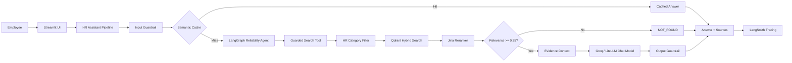
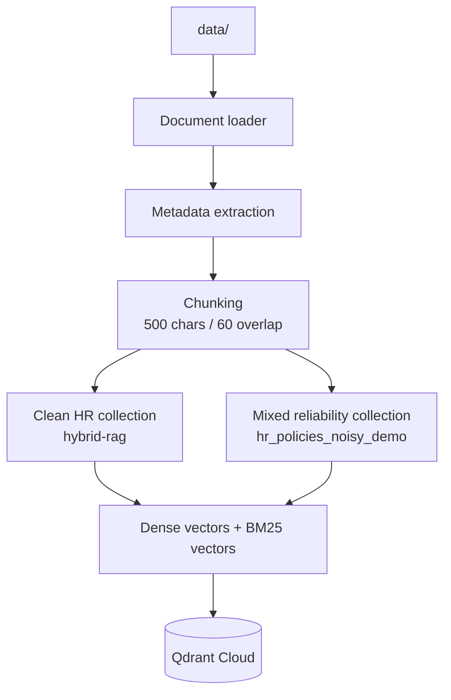
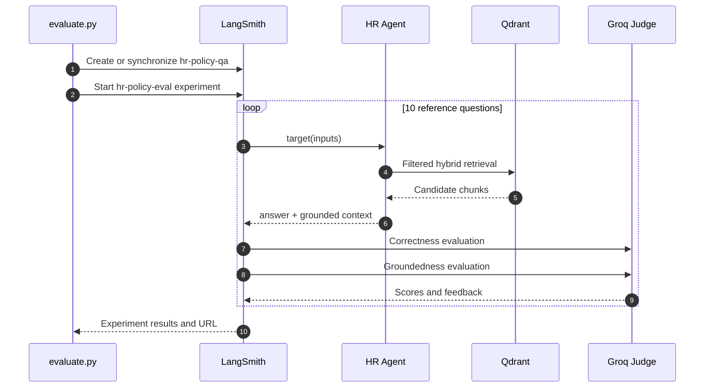
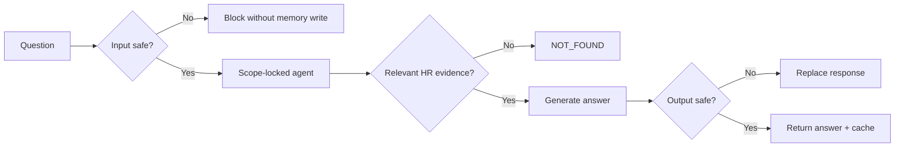

# HR Atlas

<div align="center">

### Enterprise HR Policy Intelligence

**Grounded answers. Structural scope control. Observable evaluation.**

[](https://www.python.org/)
[](https://streamlit.io/)
[](https://langchain-ai.github.io/langgraph/)
[](https://qdrant.tech/)
[](https://smith.langchain.com/)

An enterprise-oriented hybrid RAG assistant that answers HR policy questions from a controlled document corpus, rejects out-of-scope requests, and evaluates answer quality with correctness and groundedness judges.

</div>

> **Status:** Active prototype / production-oriented reference implementation
> **Primary interface:** Streamlit
> **Evaluation dataset:** `hr-policy-qa`
> **Default retrieval:** Qdrant hybrid dense + BM25 search, followed by Jina reranking

---

## Contents

- [Why HR Atlas](#why-hr-atlas)
- [Capabilities](#capabilities)
- [Architecture](#architecture)
- [Request lifecycle](#request-lifecycle)
- [Security and reliability model](#security-and-reliability-model)
- [Repository map](#repository-map)
- [Prerequisites](#prerequisites)
- [Quick start](#quick-start)
- [Configuration](#configuration)
- [Data ingestion](#data-ingestion)
- [Evaluation](#evaluation)
- [Red-team testing](#red-team-testing)
- [Operational guidance](#operational-guidance)
- [Troubleshooting](#troubleshooting)
- [Development principles](#development-principles)

---

## Why HR Atlas

HR policy assistants fail in predictable ways: they retrieve semantically similar but irrelevant content, answer questions outside their mandate, lose conversational context, or cannot explain whether a response is trustworthy.

HR Atlas addresses those failure modes with defense in depth:

| Risk | Control |
|---|---|
| Off-topic or adversarial prompts | Input safety classifier and identity-locked system prompt |
| Cross-domain retrieval | Hard category allow-list before reranking |
| Weak semantic matches | Jina relevance threshold and `NOT_FOUND` response |
| Unsupported claims | Retrieved context is evaluated for groundedness |
| Repeated expensive queries | In-memory semantic cache with threshold, TTL, and bounded size |
| Silent regressions | LangSmith traces, datasets, experiments, and red-team baselines |

## Capabilities

- **Policy-grounded answers:** answers are generated from indexed HR policy documents.
- **Hybrid retrieval:** combines dense embeddings and Qdrant BM25 sparse retrieval.
- **Reranking:** Jina reranker narrows a 12-document candidate set to the top 5 results.
- **Scope enforcement:** only approved HR policy categories can pass the guarded search tool.
- **Relevance gating:** low-confidence retrieval returns a controlled not-found response instead of a guess.
- **Conversation memory:** LangGraph `InMemorySaver` preserves thread-local context.
- **Semantic caching:** near-duplicate questions can bypass retrieval and model inference.
- **Safety screening:** input and output checks use a LiteLLM-compatible safeguard model or Groq fallback.
- **Multi-format ingestion:** `.txt`, `.pdf`, `.docx`, and `.pptx`.
- **Evaluation:** 10 reference examples scored on correctness and groundedness.
- **Adversarial testing:** plain baseline vs guarded pipeline comparison.
- **Observability:** LangSmith tracing for application runs, guardrails, cache events, and evaluations.

---

## Architecture



### Data and indexing flow



### Evaluation flow



> **Diagram rendering:** GitHub and modern Markdown viewers render these Mermaid diagrams interactively. They are intentionally source-controlled, so architecture remains reviewable without an external design tool.

---

## Request lifecycle

1. **Receive:** Streamlit sends the user question with a thread ID.
2. **Screen input:** the safety model checks prompt injection, identity reassignment, harmful content, and sensitive-data requests.
3. **Check cache:** semantic similarity is compared against fresh cache entries.
4. **Retrieve:** the agent calls the guarded search tool.
5. **Constrain scope:** Qdrant results are hard-filtered to `HR_POLICY_CATEGORIES`.
6. **Rerank:** Jina reranks the candidate set.
7. **Gate relevance:** results below `RELEVANCE_THRESHOLD` become `NOT_FOUND`.
8. **Generate:** the LangGraph agent answers using the retrieved evidence.
9. **Screen output:** the generated answer is checked before it is returned.
10. **Trace:** the request, guardrails, retrieval, and cache events are available through LangSmith when enabled.

---

## Security and reliability model

The deployed path is the guarded path:



Important boundaries:

- `build_hr_assistant()` uses the clean HR collection.
- `build_reliability_assistant()` uses the mixed HR + noise collection for reliability testing.
- `build_plain_assistant()` is retained only as a red-team baseline and does not represent the deployed security posture.
- The default input guardrail fails closed on provider errors; output behavior is configurable through environment variables.
- API keys are loaded from `.env` and must never be committed.

---

## Repository map

```text
.
├── app.py                         # Streamlit application
├── evaluate.py                    # LangSmith evaluation entry point
├── redteam_test.py                # Plain vs guarded adversarial comparison
├── demo_reliability.py            # Reliability demonstration entry point
├── main.py                        # Lightweight application/demo entry point
├── langgraph.json                 # LangGraph Studio graph configuration
├── pyproject.toml                 # Project metadata and dependencies
├── requirements.txt               # Pip-compatible dependency list
├── data/                          # Local policy corpus (not committed)
├── hr_assistant/
│   ├── agent.py                   # LangGraph agent construction
│   ├── config.py                  # Environment-backed configuration
│   ├── document_loader.py         # TXT/PDF/DOCX/PPTX loading
│   ├── embeddings.py              # Jina embedding model
│   ├── evaluation.py              # Dataset sync and evaluation runner
│   ├── guardrails.py              # Input/output safety checks
│   ├── ingest.py                  # Collection ingestion CLI
│   ├── pipeline.py                # Builders, cache, guardrails, asking
│   ├── reranker.py                # Jina reranking
│   ├── semantic_cache.py          # In-memory semantic cache
│   ├── tools.py                   # Plain and guarded retrieval tools
│   └── vector_store.py            # Qdrant client and retriever setup
└── results/                       # Generated evaluation/red-team artifacts
```

---

## Prerequisites

- Python **3.13 or newer**
- A Qdrant Cloud collection or self-hosted Qdrant endpoint
- Jina API access for embeddings and reranking
- Groq API access for the primary/fallback chat model and judge
- LangSmith API access for tracing and evaluation
- Optional LiteLLM gateway for routing the primary model and safeguard model

The hostname shown by a Qdrant Cloud endpoint may include a provider/region label such as `gcp`. That identifies the managed Qdrant deployment location; it does not mean the application is using a Google Cloud SDK or a Google Cloud project.

---

## Quick start

### 1. Create the environment

Using `uv`:

```powershell
uv sync
.\.venv\Scripts\Activate.ps1
```

Using standard Python tooling:

```powershell
py -3.13 -m venv .venv
.\.venv\Scripts\Activate.ps1
python -m pip install -r requirements.txt
```

### 2. Configure secrets

Create `.env` in the repository root:

```dotenv
JINA_API_KEY=your_jina_key
QDRANT_URL=https://your-qdrant-endpoint
QDRANT_API_KEY=your_qdrant_key
GROQ_API_KEY=your_groq_key

LANGSMITH_API_KEY=your_langsmith_key
LANGSMITH_TRACING=true
LANGSMITH_PROJECT=hybrid-rag
```

Never paste real credentials into source files, commits, issues, screenshots, or README examples.

### 3. Ingest the policy corpus

Place supported policy files under `data/`, then run:

```powershell
python -m hr_assistant.ingest
```

For a complete rebuild:

```powershell
python -m hr_assistant.ingest --force
```

Only one collection:

```powershell
python -m hr_assistant.ingest --hr-only
python -m hr_assistant.ingest --noisy-only
```

### 4. Start the application

```powershell
streamlit run app.py
```

### 5. Open the application

Streamlit normally serves the UI at:

```text
http://localhost:8501
```

---

## Configuration

| Variable | Default | Purpose |
|---|---:|---|
| `DATA_DIR` | `data/` | Source document directory |
| `QDRANT_URL` | required | Qdrant endpoint |
| `QDRANT_API_KEY` | required | Qdrant authentication |
| `QDRANT_COLLECTION_NAME` | `hybrid-rag` | Clean HR collection |
| `QDRANT_NOISY_COLLECTION_NAME` | `hr_policies_noisy_demo` | Mixed reliability-test collection |
| `QDRANT_TIMEOUT_SECONDS` | `30` | Qdrant request timeout |
| `JINA_API_KEY` | required | Embeddings and reranking |
| `EMBEDDING_MODEL_NAME` | `jina-embeddings-v2-base-en` | Embedding model |
| `RERANKER_MODEL_NAME` | `jina-reranker-v2-base-multilingual` | Reranker model |
| `TOP_K_RESULTS` | `5` | Final evidence count |
| `RERANK_CANDIDATE_K` | `12` | Candidate count before reranking |
| `RELEVANCE_THRESHOLD` | `0.35` | Minimum reranker score |
| `SEMANTIC_CACHE_THRESHOLD` | `0.93` | Cache similarity threshold |
| `SEMANTIC_CACHE_MAX_ENTRIES` | `500` | Cache capacity |
| `SEMANTIC_CACHE_TTL_SECONDS` | `3600` | Cache entry lifetime |
| `GROQ_BASE_URL` | Groq OpenAI-compatible endpoint | Groq API endpoint |
| `FALLBACK_MODEL_NAME` | `openai/gpt-oss-120b` | Fallback chat model |
| `LITELLM_BASE_URL` | `http://localhost:4000/v1` | Optional gateway |
| `LITELLM_API_KEY` | unset | Enables LiteLLM primary route |
| `LANGSMITH_ENDPOINT` | LangSmith cloud | Observability endpoint |
| `LANGSMITH_PROJECT` | `hybrid-rag` | Trace project |
| `LANGSMITH_TRACING` | `true` | Enable/disable tracing |
| `GUARDRAIL_PROVIDER` | `litellm` | Safety provider selector |
| `GUARDRAIL_FAIL_OPEN_INPUT` | `false` | Input provider-error behavior |
| `GUARDRAIL_FAIL_OPEN_OUTPUT` | `true` | Output provider-error behavior |

---

## Data ingestion

Supported source formats:

```text
data/
├── annual_leave.txt
├── travel_policy.pdf
├── remote_work.docx
└── noise/
    ├── finance_report.pdf
    └── sales_overview.pptx
```

The loader extracts a `Policy Category:` value where available and stores metadata including:

- `source`
- `filename`
- `file_type`
- `category`
- `policy_category`
- `is_hr`

The clean collection contains HR policy documents only. The noisy collection intentionally mixes HR and non-HR documents so scope controls can be tested against realistic retrieval noise.

---

## Evaluation

The evaluation dataset currently contains **10** hand-written question/reference-answer pairs in [`hr_assistant/evaluation_dataset.py`](hr_assistant/evaluation_dataset.py).

Run:

```powershell
python evaluate.py
```

The evaluator:

1. Creates or synchronizes the `hr-policy-qa` LangSmith dataset.
2. Runs each question through the real agent.
3. Rebuilds the same filtered and reranked context used by the search tool.
4. Scores **correctness** against the reference answer.
5. Scores **groundedness** against the retrieved context.
6. Publishes an `hr-policy-eval-*` experiment to LangSmith.

The dataset is synchronized rather than blindly reused, so removed or added local test cases are reflected in LangSmith on the next run.

> Evaluation is network-bound: each case can call Qdrant, Jina, the answer model, and two judge paths. A run that remains active without new output is not necessarily an infinite loop.

---

## Red-team testing

Run the adversarial comparison after ingestion:

```powershell
python redteam_test.py
```

The script compares:

- **Plain:** system prompt and unrestricted retrieval baseline.
- **Guarded:** input/output safety checks, identity lock, HR category filter, rerank threshold, and reliability prompt.

Generated artifacts:

```text
results/redteam_results.json
results/RED_TEAM_TEST_RESULTS.md
```

---

## Operational guidance

### Avoid duplicate evaluation runs

Before starting a new evaluation on Windows:

```powershell
Get-CimInstance Win32_Process -Filter "Name = 'python.exe'" |
  Where-Object { $_.CommandLine -like '*evaluate.py*' } |
  Select-Object ProcessId, CommandLine
```

Start only one `evaluate.py` process unless parallel experiments are intentional.

### Observability checklist

- Confirm `LANGSMITH_TRACING=true`.
- Confirm `LANGSMITH_API_KEY` belongs to the workspace you are viewing.
- Open **View all datasets** in LangSmith instead of only the project-linked dataset panel.
- Search for dataset `hr-policy-qa` and project `hybrid-rag`.
- Use the experiment URL printed by the evaluation runner.

### Secret handling

- `.env` is ignored by Git.
- Do not commit API keys.
- Rotate a key immediately if it appears in logs, screenshots, or shared output.
- Keep provider endpoints and credentials configurable through environment variables.

---

## Troubleshooting

| Symptom | Likely cause | Resolution |
|---|---|---|
| `Missing required env vars` | `.env` is absent or incomplete | Add `JINA_API_KEY`, `QDRANT_URL`, and `QDRANT_API_KEY` |
| `Qdrant collection is missing or empty` | Ingestion has not completed | Run `python -m hr_assistant.ingest` |
| LangSmith shows no dataset in the project view | Dataset is not linked in that view | Select **View all datasets**, then search `hr-policy-qa` |
| Evaluation appears stuck | Multiple remote calls or duplicate processes | Inspect processes and network activity; run one evaluation process |
| `401 Invalid token` from LangSmith | Wrong workspace/key or expired key | Verify `.env`, workspace, and LangSmith login |
| `Jina` request fails | Missing/invalid Jina key or network issue | Verify `JINA_API_KEY` and rerun the focused command |
| Answers say `NOT_FOUND` | Query is out of scope or below threshold | Check policy category metadata and `RELEVANCE_THRESHOLD` |
| Cache does not hit | Similarity is below `0.93`, entry expired, or cache restarted | Inspect logs and adjust cache settings deliberately |

---

## Development principles

- Keep retrieval scope enforcement structural, not prompt-only.
- Prefer evidence-backed refusal over unsupported completion.
- Keep clean and noisy corpora separate so reliability tests remain meaningful.
- Reuse the production retrieval path in evaluation context reconstruction.
- Treat observability and evaluation as part of the application, not post-processing.
- Keep provider-specific behavior behind configuration and small integration modules.
- Validate changes with the narrowest relevant command before running broader suites.

## License and policy data

This repository is intended for internal HR policy assistance and engineering evaluation. Policy documents under `data/` may contain confidential or organization-specific material and should be governed according to the organization's data-classification and retention requirements.